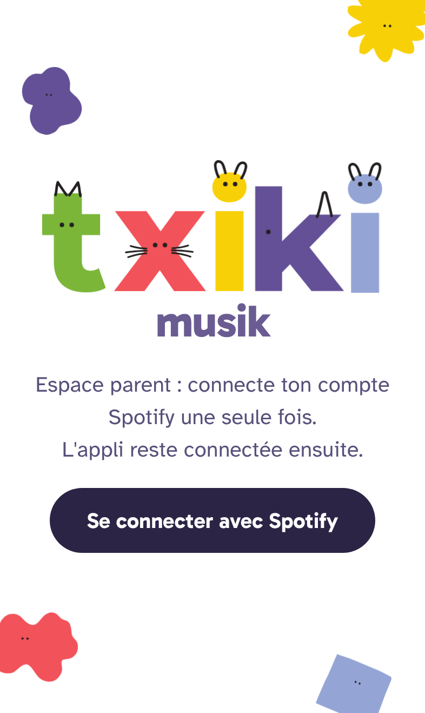
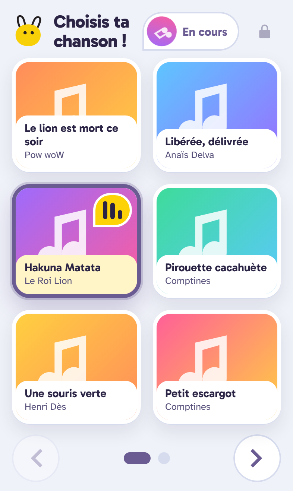
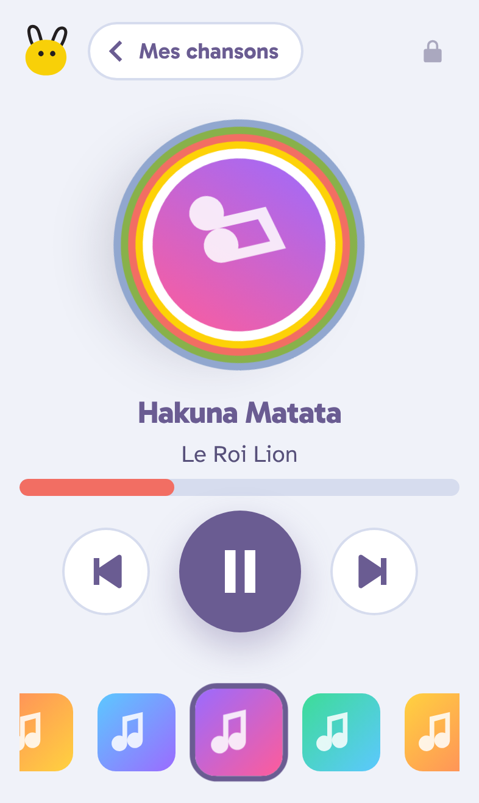
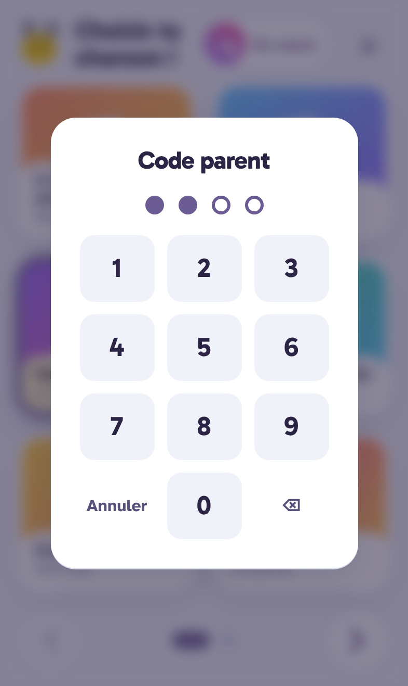
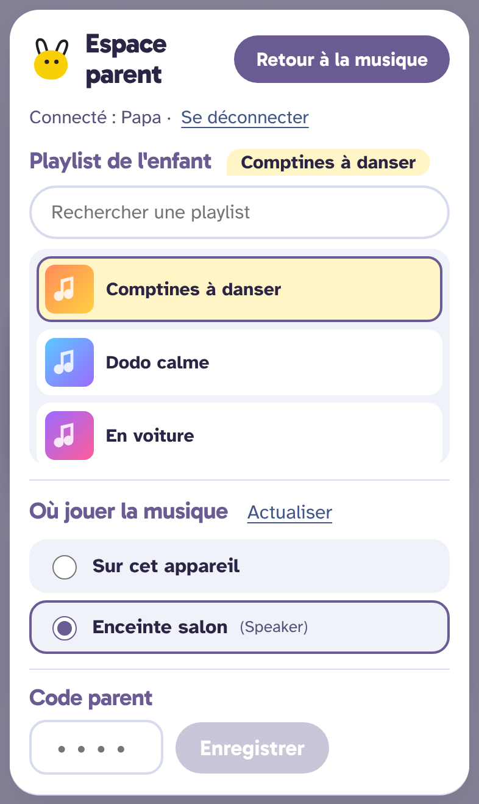
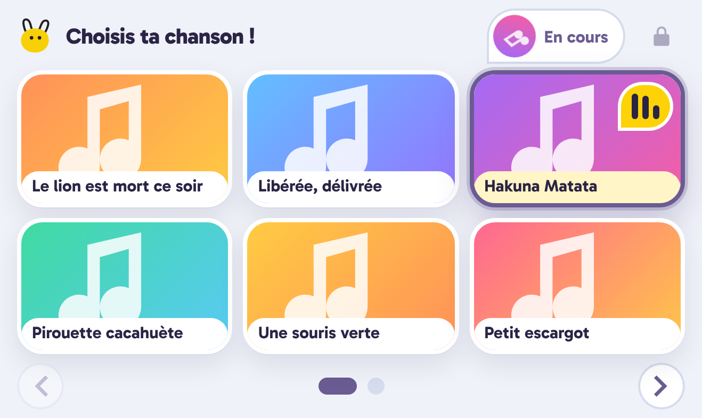
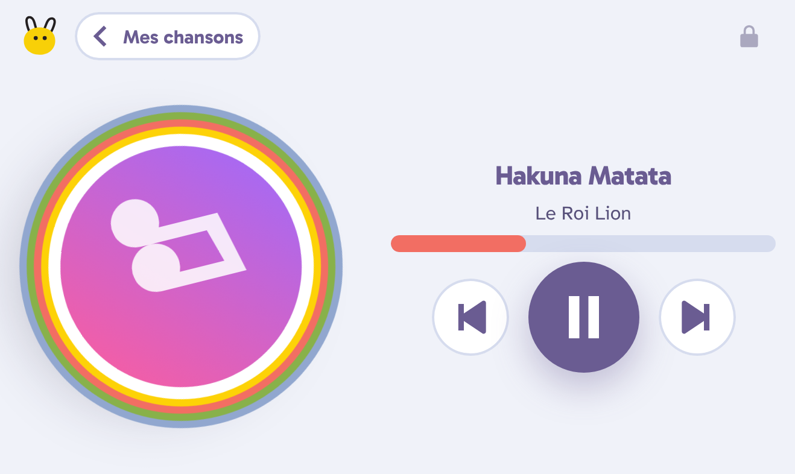

# txikimusik

Une appli Spotify pour enfant, aux couleurs de [Txiki](https://txikiapp.eus) : un parent se connecte
une fois et choisit une playlist ; l'enfant parcourt les chansons en grille (6 par écran) et touche
celle qu'il veut écouter. Elle se lance aussitôt, et suivant / précédent continuent dans la playlist.

En ligne sur <https://txikimusik.vercel.app/>.

- **Connexion parent persistante** : OAuth Spotify (PKCE, sans secret). Le jeton de rafraîchissement
  est gardé sur l'appareil, la session ne se ferme que si le parent se déconnecte ou révoque l'accès.
- **Espace parent protégé par un code** (icône cadenas) : playlist, appareil de lecture, déconnexion.
- **Lecture** dans le navigateur (Web Playback SDK) ou sur un autre appareil Spotify Connect
  (enceinte, téléphone, ordinateur).

## Captures (iPhone)

<table>
  <tr>
    <td align="center"><br>Connexion</td>
    <td align="center"><br>Choix de la chanson</td>
    <td align="center"><br>Lecteur</td>
  </tr>
  <tr>
    <td align="center"><br>Code parent</td>
    <td align="center"><br>Espace parent</td>
    <td></td>
  </tr>
</table>

<table>
  <tr>
    <td align="center"><br>Grille en paysage</td>
    <td align="center"><br>Lecteur en paysage</td>
  </tr>
</table>

Captures faites avec Playwright (profil iPhone 15) et des réponses Spotify simulées : les titres sont
réels, les pochettes sont des images de remplacement.

## Pré-requis

- Un compte **Spotify Premium** (obligatoire pour piloter la lecture via l'API).
- Une app sur <https://developer.spotify.com/dashboard> :
  - API : *Web API* et *Web Playback SDK*
  - Redirect URIs : `http://127.0.0.1:5173/` (dev) et l'URL de production `https://txikimusik.vercel.app`
  - En mode développement, ajoutez le compte du parent dans *User Management*.

## Lancer en local

```
cp .env.example .env.local   # renseigner VITE_SPOTIFY_CLIENT_ID
npm install
npm run dev                  # http://127.0.0.1:5173 (pas "localhost", refusé par Spotify)
npm test
```

## Production

En ligne sur <https://txikimusik.vercel.app/> (projet Vercel `txikimusik`). Variables à définir dans Vercel
**avant** le build, car elles sont intégrées au bundle : `VITE_SPOTIFY_CLIENT_ID` et `VITE_REDIRECT_URI`
(`https://txikimusik.vercel.app`, sans `/` final, exactement comme dans les Redirect URIs de l'app Spotify).

Ailleurs, `npm run build` puis `npm start` sert `dist/` avec Express.

Sur tablette, « Ajouter à l'écran d'accueil » ouvre l'appli en plein écran.

## Limites connues

- La lecture dans le navigateur ne fonctionne pas sur Safari iOS : choisissez alors un autre appareil
  dans l'espace parent.
- Un appareil Spotify Connect inactif depuis longtemps disparaît de la liste : ouvrez Spotify dessus.
- Seules les playlists du compte (créées ou collaboratives) sont proposées.
